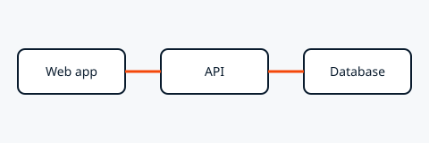

<!-- page 1001: engineering-handbook.md -->

# Engineering Handbook

Source: https://example.atlassian.net/wiki/spaces/ENG/pages/1001/Engineering+Handbook · Updated: 2026-10-08

Everything a new engineer needs, in one place. Start with [Onboarding](engineering-handbook/onboarding.md), then read the [Architecture overview](engineering-handbook/architecture-overview.md).

## Owners

Maintained by @Priya Shah and @Sam Lee. Questions go to the `#eng-help` channel.

> [!NOTE]
> This handbook is the source of truth. If something here is wrong, fix it.

<!-- page 1002: engineering-handbook/onboarding.md -->

# Onboarding

Source: https://example.atlassian.net/wiki/spaces/ENG/pages/1002/Onboarding · Updated: 2026-10-08

Your first two weeks, step by step. Day-by-day details are in [First week](engineering-handbook/onboarding/first-week.md).

## Before day one

- [x] Laptop ordered
- [x] Accounts requested
- [ ] Buddy assigned: @Sam Lee

## Who to ask

| Topic | Contact |
| --- | --- |
| Access and accounts | @Priya Shah |
| Code review | @Sam Lee |

<!-- page 1003: engineering-handbook/onboarding/first-week.md -->

# First week

Source: https://example.atlassian.net/wiki/spaces/ENG/pages/1003/First+week · Updated: 2026-10-08

- Day 1: set up your machine
- Day 2: ship a small fix, tracked in [ENG-42](https://example.atlassian.net/browse/ENG-42)
- Day 3 to 5: pair on the current sprint

## Set up your machine

```bash
git clone git@example.com:acme/app.git
cd app
npm ci
npm test
```

**Troubleshooting**

If tests fail on a fresh clone, check your Node version against `.nvmrc`.

<!-- page 1004: engineering-handbook/architecture-overview.md -->

# Architecture overview

Source: https://example.atlassian.net/wiki/spaces/ENG/pages/1004/Architecture+overview · Updated: 2026-10-08

Three services, one direction of traffic.



## Services

<table><tr><th><p>Service</p></th><th><p>Owner</p></th><th><p>Status</p></th></tr><tr><td><p>Web app</p></td><td><p>@Sam Lee</p></td><td><p>[LIVE]</p></td></tr><tr><td><p>API</p></td><td><p>@Priya Shah</p></td><td><p>[MIGRATING]</p></td></tr><tr><td colspan="3"><p>The database is managed by the platform team.</p></td></tr></table>

> [!WARNING]
> Never connect to the production database from a laptop.

<!-- page 1005: engineering-handbook/release-checklist.md -->

# Release checklist

Source: https://example.atlassian.net/wiki/spaces/ENG/pages/1005/Release+checklist · Updated: 2026-10-08

Next release: 2026-10-20 \[IN PROGRESS\]

- [x] Changelog written
- [ ] Staging sign-off by @Priya Shah
- [ ] Announce in `#releases`

- **Decision:** Releases ship on Tuesdays, never Fridays.
